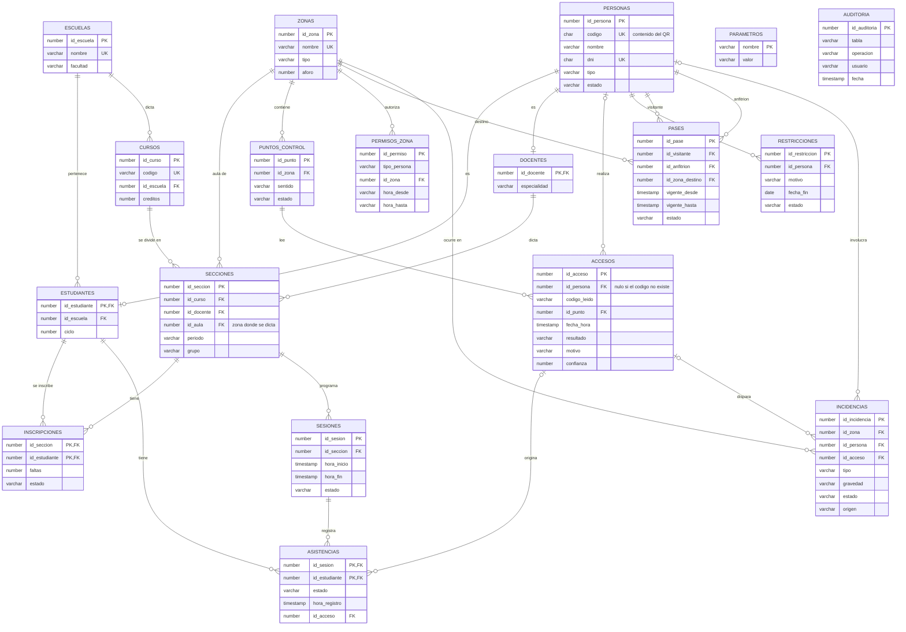

# Sistema de Control de Acceso, Asistencia y Seguridad Universitaria

Curso: Administración de Base de Datos, Ingeniería de Sistemas, UNMSM. Estudiante: Mathias.
Base de datos: Oracle XE 21c (Docker, servicio `XEPDB1`), esquema `acceso_owner`.

## 1. El sistema en una frase

Una persona pasa por un punto de control (puerta, aula o laboratorio) con **QR + reconocimiento facial**, y Oracle decide **en una sola transacción** si se autoriza el ingreso, si cuenta como asistencia a una sesión de clase y si debe generarse una incidencia.

## 2. Modelo de datos (18 tablas, 24 claves foráneas)



Integridad: 18 claves primarias, 24 foráneas, 7 únicas, 29 checks con nombre y 8 índices secundarios. `parametros` guarda los umbrales (faltas máximas, minutos de tardanza, intentos, umbral LBPH, zona horaria) y `auditoria` recibe los triggers.

## 3. Procedimientos PL/SQL y reglas

Todos son procedimientos sueltos del esquema dueño. Un acceso denegado **no es un error**: se registra y se devuelve por parámetros `OUT`. Los errores reales usan `raise_application_error` (`-20001` entrada inválida, `-20002` inexistente, `-20003` estado inválido, `-20004` parámetro faltante, `-20005` duplicado, `-20099` inesperado) y hacen `rollback`.

| Procedimiento | Función |
|---|---|
| `p_verificar_persona` | Busca el código del QR (reemplaza al CSV): nombre, tipo, estado y si existe |
| `p_registrar_acceso` | Decide y registra el acceso, la asistencia y las incidencias en una transacción |
| `p_cerrar_sesion` | Cierra la sesión, marca las faltas e inhabilita al superar el límite |
| `p_emitir_pase`, `p_revocar_pase` | Pases de visitantes |
| `p_registrar_restriccion`, `p_levantar_restriccion` | Restricciones de ingreso |
| `p_registrar_incidencia`, `p_resolver_incidencia` | Incidencias del vigilante |
| `p_registrar_persona`, `p_modificar_persona`, `p_eliminar_persona` | CRUD de personas (alta con subtipo en una transacción, baja lógica si hay historial) |
| `p_listar_personas`, `p_buscar_personas` | Consultas con `SYS_REFCURSOR` |
| `p_obtener_parametro` | Lee un parámetro (el punto de acceso lee `UMBRAL_LBPH`) |

**Reglas de `p_registrar_acceso`, en este orden:**

1. Código inexistente: `codigo_inexistente` (`id_persona` nulo).
2. Persona con estado distinto de activo: `persona_inactiva`.
3. Rostro que no coincide: `rostro_no_coincide`.
4. Restricción vigente: `persona_restringida` y se crea una incidencia de gravedad **alta**.
5. Autorización por zona. Visitante: necesita un pase activo y vigente (en la puerta basta cualquiera; en otra zona, uno de esa zona) o `sin_pase_vigente`. Los demás: fila en `permisos_zona` (`zona_no_autorizada`) y hora local dentro de la ventana (`fuera_de_horario`).
6. Si se permite en un aula o laboratorio: el estudiante inscrito con una sesión entre 10 minutos antes del inicio y `MIN_MAX_TARDANZA` después recibe `presente` (hasta `MIN_TARDANZA` minutos) o `tardanza`, sin duplicar ni degradar; el docente solo hace pasar la sesión a `en_curso`.
7. Si se deniega: al llegar a `INTENTOS_PARA_INCIDENCIA` denegados en `MIN_VENTANA_INTENTOS` minutos (misma zona y misma persona o código) se crea una incidencia `intentos_reiterados` de gravedad **media**, salvo que ya haya una abierta equivalente.

Los umbrales se leen de la tabla `parametros`; no están escritos en el código.

**Reportes (`SYS_REFCURSOR`):** `r_asistencia_seccion`, `r_asistencia_sesion`, `r_alumnos_en_riesgo`, `r_ranking_tardanzas`, `r_accesos_denegados` (con `ROLLUP`), `r_incidencias`, `r_pases_vigentes`, `r_uso_aulas_vs_sesiones` y `r_flujo_por_hora`.

## 4. Roles, permisos y tablespaces

Los roles **solo tienen `EXECUTE` sobre procedimientos; ninguno tiene privilegios sobre tablas** (comprobado: 0 privilegios sobre tablas). Los procedimientos usan los derechos de su propietario.

| Usuario | Rol | Puede ejecutar |
|---|---|---|
| `u_punto` | `rol_punto_control` | `p_verificar_persona`, `p_registrar_acceso`, `p_obtener_parametro` |
| `u_vigilante` | `rol_vigilante` | Lo anterior, pases, restricciones, incidencias, `p_buscar_personas` y reportes de seguridad |
| `u_docente` | `rol_docente` | Reportes de asistencia |
| `u_admin` | `rol_admin` | Todos los procedimientos y funciones |

| Tablespace | Tamaño inicial / máximo | Contenido |
|---|---|---|
| `ts_acceso_datos` | 50 MB / 500 MB | Tablas maestras, académicas y de seguridad, con sus claves |
| `ts_acceso_log` | 50 MB / 500 MB | Tablas de alto volumen: `accesos`, `asistencias`, `auditoria` |
| `ts_acceso_idx` | 30 MB / 200 MB | Los 8 índices secundarios |

Los tres tienen `autoextend`. Auditoría: los triggers `trg_aud_personas` y `trg_aud_restricciones` guardan operación, usuario real de la sesión y el detalle de lo que cambió.

## 5. Evidencia de las pruebas

Salida real de cada ejecución en `docs/evidencia/` (detalle por etapa en `docs/AVANCE.md`).

| Archivo | Qué demuestra |
|---|---|
| `etapa1_*.txt` | Carga desde cero: 18 tablas, 17 personas, índices y tablespaces |
| `test_03.txt` | Todos los motivos de denegación, visitantes y pases, asistencia `presente` y `tardanza` sin duplicar, `intentos_reiterados`, `p_cerrar_sesion` con inhabilitación, CRUD y errores controlados |
| `reportes.txt` | Los 9 reportes impresos con `VARIABLE` y `PRINT`, y sus errores controlados |
| `permisos.txt` | `u_punto` no puede hacer `SELECT` sobre `accesos` (`ORA-00942`) pero sí ejecutar `p_registrar_acceso`; matriz por rol; bitácora de auditoría |

## 6. Cómo reproducir

```
00_admin.sql (SYSTEM) -> 01_esquema.sql -> 02_datos.sql -> 03_procedimientos.sql
-> 04_reportes.sql -> 05_triggers.sql -> 06_permisos.sql   (los cinco últimos como acceso_owner)
Pruebas: test_03.sql, test_04.sql, test_05_06.sql          Reinicio: 99_reset.sql
```

## 7. Pendientes y límites conocidos

- Las marcas de tiempo se guardan en hora del servidor (UTC en este contenedor); solo las ventanas horarias de `permisos_zona` se evalúan en `America/Lima`.
- Un docente solo puede ver reportes; cerrar sesiones es del administrador. Falta validar que un docente consulte únicamente sus propias secciones.
- `p_registrar_acceso` no distingue el sentido del punto: un visitante con el pase vencido tampoco puede salir por la puerta de salida.
- La auditoría cubre `personas` y `restricciones`, no pases ni incidencias.
- No hay procedimientos para crear secciones, sesiones ni inscripciones (se cargan por script).
- Los rostros y modelos LBPH siguen en disco (`datos/`, fuera del repositorio), no en la base.
- Las claves de los usuarios de la base están en `00_admin.sql` por ser un proyecto de curso.
